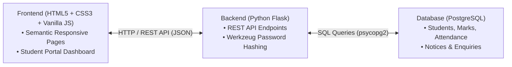
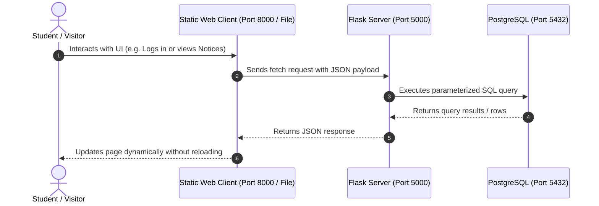
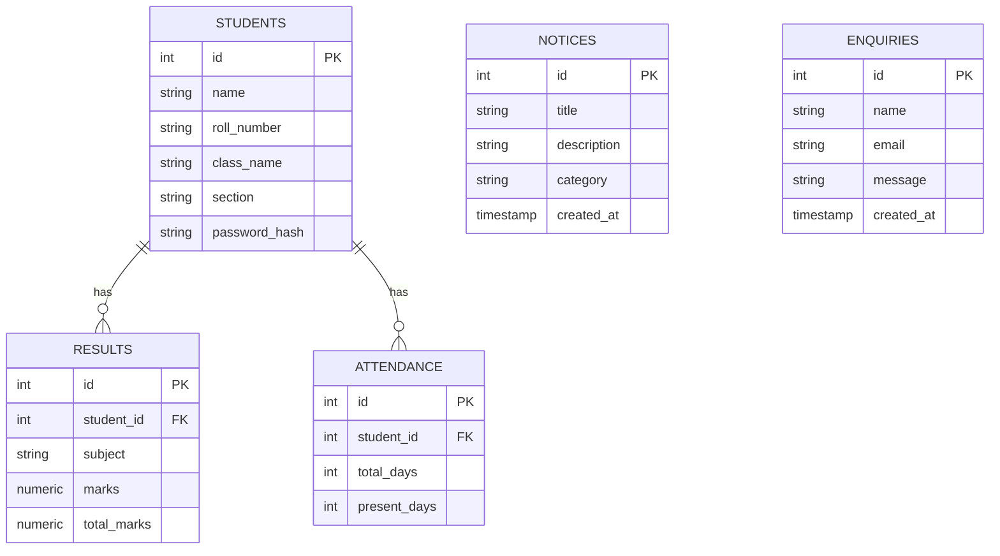

<div align="center">

# 🏛️ SchoolHub — School Information & Management Portal

[](https://developer.mozilla.org/)
[](https://flask.palletsprojects.com/)
[](https://www.postgresql.org/)
[](https://github.com/AyushSrivastava1818/WebDev-Project-1043-1048-)

**A clean, full-stack school website and student portal developed for B.Tech Web Development Lab.**  
*Combines an institutional public website with a secure student attendance and examination marks portal.*

---

</div>

## 📌 Table of Contents
- [Simple Project Architecture](#-simple-project-architecture)
- [How Data Flows](#-how-data-flows)
- [Database Schema](#-database-schema)
- [Key Features](#-key-features)
- [Technology Stack](#-technology-stack)
- [Quick Start & Setup](#-quick-start--setup)
- [API Endpoints](#-api-endpoints)
- [Project Team & Work Distribution](#-project-team--work-distribution)

---

## 🏗️ Simple Project Architecture

The application uses a standard 3-tier web architecture:



---

## 🔄 How Data Flows

A simple step-by-step lifecycle of how information moves through the system:



---

## 🗃️ Database Schema

The database consists of 5 simple, related tables in PostgreSQL:



---

## 🌟 Key Features

### 1. Public School Website
- **Clean Academic Styling**: Custom institutional CSS design system reflecting heritage aesthetic (Ivory, Burgundy, Forest Green, Gold).
- **Home Page**: Hero banner, Principal's welcome note, key school statistics, academic divisions overview, latest announcements, and campus highlights.
- **About Us**: School founding history (established 1948), vision, mission, and major chronological milestones.
- **Academics**: Interactive tabbed stream switcher (**Science**, **Commerce**, and **Humanities**) with subject combinations and assessment scheme.
- **Campus Facilities**: Showcases the Central Library, Science Laboratories, Sports Pavilion, Atal Tinkering Lab, and Auditorium.
- **Notice Board**: Displays live notices filtered by category (*Academic, Event, Sports, General*) with real-time keyword search.
- **Contact & Admissions**: Campus address, phone, email, visiting hours, and functional admission enquiry form.

### 2. Student Portal
- **Login**: Authenticates roll number and password against backend REST API with session storage.
- **Quick Demo Fill**: One-click demo credential buttons for evaluation.
- **Student Dashboard**:
  - Profile card with Name, Roll Number, Class, and Section.
  - Attendance tracker with visual progress bar and exam eligibility status.
  - Term examination marks transcript table with subject breakdown and overall grade tier.
  - Recent school circulars feed.
  - Secure sign-out action and printable transcript support.

---

## 💻 Technology Stack

- **Frontend**: Standard HTML5, CSS3, Vanilla ES6+ JavaScript (Zero external framework dependencies).
- **Backend**: Python 3, Flask, Flask-CORS, Werkzeug Security, psycopg2.
- **Database**: PostgreSQL 14+.
- **Design Colors**: Warm Ivory (`#F8F5EE`), Deep Burgundy (`#713B37`), Forest Green (`#243228`), Antique Gold (`#B68A50`), Charcoal (`#2A2824`).

---

## 🚀 Quick Start & Setup

### Step 1: Database Setup
Make sure PostgreSQL is running on port `5432`, then run:
```bash
cd backend
python init_db.py
```
*This creates the `schoolhub` database, tables from `schema.sql`, and sample records from `seed.sql`.*

### Step 2: Start Flask Backend
```bash
cd backend
python app.py
```
*Backend runs on `http://localhost:5000`.*

### Step 3: Run Frontend
Open `frontend/index.html` directly in any web browser, or serve it using Python's built-in static server:
```bash
cd frontend
python -m http.server 8000
```
*Frontend runs on `http://localhost:8000`.*

---

## 📡 API Endpoints

| Method | Endpoint | Description |
|---|---|---|
| `GET` | `/api/health` | System health and database connectivity |
| `GET` | `/api/notices` | All notices (optional filter: `?category=Academic`) |
| `GET` | `/api/notices/latest` | Latest 4 notices for the homepage |
| `POST` | `/api/contact` | Submits enquiry into `enquiries` table |
| `POST` | `/api/login` | Authenticates student roll number & password |
| `POST` | `/api/logout` | Clears active student session |
| `GET` | `/api/student/profile` | Student profile info (`?student_id=1`) |
| `GET` | `/api/student/results` | Subject marks, percentage & grade (`?student_id=1`) |
| `GET` | `/api/student/attendance` | Attendance count, percentage & eligibility (`?student_id=1`) |

### Demo Student Login Accounts
- **Alexander Vance**: Roll `SCH202601` | Password `password123` *(Class 12-A, 93.3% Attendance)*
- **Sophia Montgomery**: Roll `SCH202602` | Password `password123` *(Class 12-A, 96.7% Attendance)*
- **Ethan Hawthorne**: Roll `SCH202603` | Password `password123` *(Class 11-B, 88.3% Attendance)*

---

## 👥 Project Team & Work Distribution

| Team Member | Module Focus | Contributions & Implemented Features |
|:---|:---|:---|
| **Avnish Yadav** | **UI Design & Core Layout (Frontend)** | • Institutional CSS Design System & typography<br>• Responsive navigation header with active link indicators<br>• Homepage (`index.html`) layout, hero banner, and Principal's address<br>• School crest branding and SVG assets |
| **Rahul Singh** | **Pages & Student Portal UI (Frontend)** | • Informational pages (`about.html`, `academics.html`, `facilities.html`)<br>• Interactive stream switcher (Science, Commerce, Humanities)<br>• Notices filtering & search client (`notices.html`)<br>• Student Portal UI (`login.html`, `dashboard.html`)<br>• Contact page & enquiry form (`contact.html`) |
| **Ayush Srivastava** | **API Core & Authentication (Backend)** | • Flask server core architecture (`app.py`)<br>• Werkzeug scrypt password hashing and verification<br>• REST API authentication endpoints (`POST /api/login`, `POST /api/logout`)<br>• Client-to-backend fetch integration with offline fallback caching |
| **Ishan Bisht** | **Results & Attendance Services (Backend)** | • Student portal API endpoints (`/api/student/profile`, `/api/student/results`)<br>• Dynamic marks calculation, percentage, and grade mapping<br>• Student attendance statistics computation & eligibility logic<br>• Server-side input validation and error handling |
| **Shivansh** | **Notices & Communication API (Backend)** | • Notice board endpoints (`/api/notices`, `/api/notices/latest`)<br>• Category-based notice filtering logic<br>• Contact form submission endpoint (`POST /api/contact`)<br>• Flask-CORS cross-origin configuration and route documentation |
| **Rohan** | **Database Schema & Management (Database)** | • PostgreSQL database schema design (`schema.sql`)<br>• Primary key / foreign key relationships with cascade rules<br>• Database connection manager (`database.py`) using `psycopg2`<br>• Automated database initializer script (`init_db.py`)<br>• Realistic sample academic seed data (`seed.sql`) |
| **Everyone** | **Documentation & Testing** | • Project architecture documentation, testing, and presentation prep |
